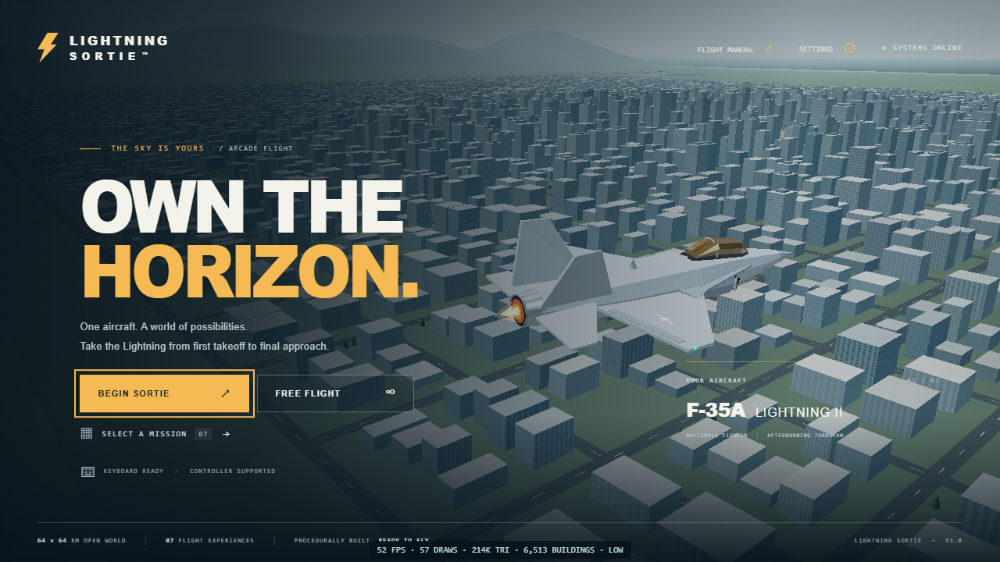
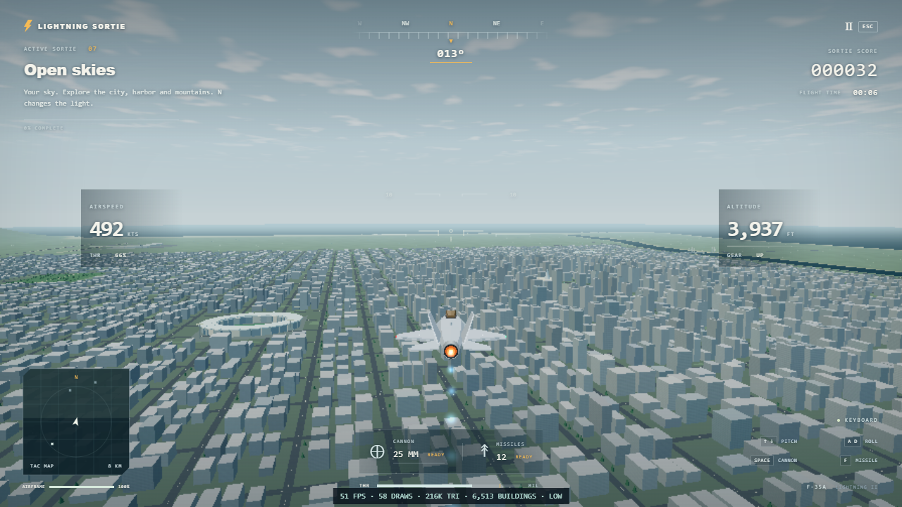

# Lightning Sortie

A complete local browser arcade flight game, built with Three.js and Vite. Fly a procedurally modeled F-35A Lightning II across a 64 × 64 km coastal region (about 40 × 40 miles), complete six scored missions, or explore in free flight.

## Screenshots

Actual captures of the running game:





## Run locally

Use Node.js 20.19+ or 22.12+ and a desktop browser with WebGL2 and hardware acceleration enabled.

```sh
npm install
npm run dev
```

Open the local URL printed by Vite. Choose **Begin Sortie** for the takeoff mission, **Select a Mission** for any stage, or **Free Flight** to explore. Click into the page before using flight controls. Audio starts after an interaction with the game.

```sh
npm run build
npm run preview
```

The production output is in `dist/`. Serve that directory with an HTTP server; opening `index.html` directly with `file://` is not supported. The build uses relative asset paths for hosting in a subdirectory. Internet access is needed to install development dependencies; the installed game and production build fetch no external models, images, textures, fonts, music, or other assets at runtime.

## Flight controls

Controls favor arcade responsiveness: releasing the pitch and roll controls levels the aircraft, banking turns it, and the throttle stays at its selected setting. The HUD shows speed in knots and altitude in feet. **Invert pitch** is available in Settings.

| Action | Keyboard | DualSense / standard gamepad |
| --- | --- | --- |
| Pitch up / down | Up / Down arrows | Left stick up / down |
| Roll left / right | A / D or Left / Right arrows | Left stick left / right |
| Rudder left / right | Q / E | Right stick left / right |
| Increase / decrease throttle | W / S | R2 / L2, or D-pad up / down |
| Hold afterburner | Shift | R1 / right bumper |
| Fire cannon | Space | Cross / A |
| Launch missile | F | Square / X |
| Toggle landing gear | G | Circle / B |
| Change camera | C | Triangle / Y |
| Pause / resume | Escape | Options / Start |
| Restart current sortie | R | Use the pause menu |
| Change time of day | N | Use Settings |

Connect a DualSense by USB or Bluetooth, then press a button while the game page is focused so the browser exposes it. Other controllers using the browser's standard gamepad mapping work too. Support depends on the browser and operating system; adaptive triggers and controller audio are not required or used. Navigate menus with the D-pad or left stick, select with Cross / A, and go back with Circle / B. Keyboard menus support Tab, Shift+Tab, and Enter.

For takeoff, raise the throttle with W, hold Shift, and press Up once speed builds. Retract the gear with G after climbing. For landing, line up with Kestrel's northbound runway, lower the gear, reduce throttle, and make a shallow descent with wings level. The landing stage starts on approach so you can practice immediately.

## Missions

All seven flight experiences are available from stage select.

| Stage | Experience |
| --- | --- |
| 01 — First light | Take off from Kestrel Airbase and climb safely. |
| 02 — City circuit | Fly a sequence of waypoint gates. |
| 03 — Knife edge | Complete a tighter precision flight course. |
| 04 — Air superiority | Engage AI aircraft with cannon and missiles. |
| 05 — Thunder run | Attack marked ground targets. |
| 06 — Coming home | Approach and land on the airbase runway. |
| 07 — Open skies | Explore freely without a required route. |

Follow the active objective and amber navigation guidance. Combat uses coral target markers. Results include score, flight time, and a letter grade; records and preferences are saved locally in the browser.

## The world

The region is deterministic and generated entirely from primitive or custom geometry, canvas textures, and seeded random values. It includes 6,513 buildings with night windows, 2,832 trees, 190 moving vehicles, road markings, farmland, mountain terrain, a river, ocean, and major landmarks:

| Landmark | Location in world metres (X, Z) |
| --- | --- |
| Kestrel Airbase | −6,000, 7,500 |
| Aster City | 1,000, −2,500 |
| Northgate International | −10,800, −15,100 |
| Crown Stadium | −3,100, −1,200 |
| Coastal Arena | 4,900, −8,400 |
| Harbor Point | 14,500, −2,200 |
| East Channel Bridge | East of the city, at Z = −1,500 |
| North Channel Bridge | Northeast of the city, at Z = −8,000 |
| Highland Ridge | −22,200, −2,200 |

North is negative Z. Kestrel's runway runs north–south at X = −6,000, from Z = 5,500 to 9,500, and is 110 metres wide. The world spans X and Z = −32,000 to 32,000.

## Performance and development

The game targets 60 FPS; actual frame rate depends on GPU, browser, resolution, and scene visibility. Use a lower graphics setting if needed. Instanced city districts and infrastructure, merged road geometry, pooled effects, and spatially hashed collision checks keep rendering and simulation work bounded. Day, dusk, night, and automatic cycling can be selected in Settings.

The recorded Intel UHD benchmark at 1280 × 720 measured about 51–55 FPS over the dense city. Steady 60 FPS has not been verified on that hardware.

Controller menus work with the D-pad and Cross / A. In Settings, use up/down to move between controls and left/right or Cross / A to change a selected value. A physical DualSense has not been available for device testing; the standard Gamepad API mappings are covered by automated input tests.

Append `?dev=1` to the local URL to enable development diagnostics. Run the automated checks with:

```sh
npm test
```

The 31 automated checks cover flight dynamics, keyboard/gamepad input, mission completion, homing missiles, landing on the generated runway, scene cleanup, and world collisions. With the development server running, `npm run test:browser` checks the menus, landing-to-results flow, restart, pause, settings, camera modes, crash recovery, and combat spawns in headless Microsoft Edge. `npm run benchmark` measures the city scene at 1280 × 720 and saves results in `test-results/`. Those browser scripts require Microsoft Edge; the game itself supports any current WebGL2 browser.

The source separates flight and input, aircraft construction, world generation, missions, effects, synthesized Web Audio, and the HTML/CSS interface. No server, API key, account, external 3D asset, or model download is required to play.

## Usage and licensing

No reuse license is granted for this project's original code or assets. Public visibility does not grant permission to copy, modify, or redistribute them. Third-party dependencies remain subject to their own licenses.
